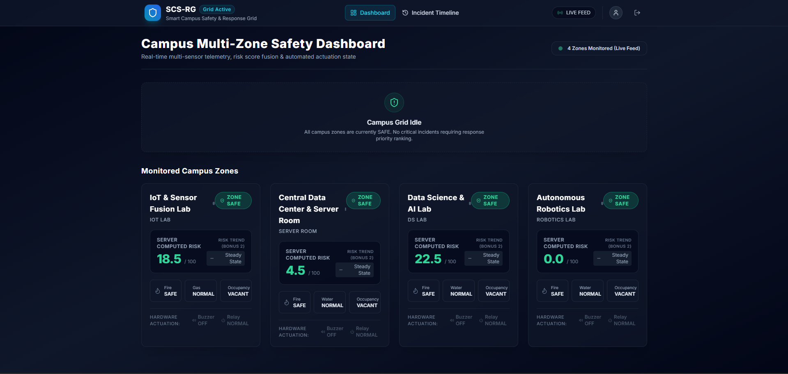
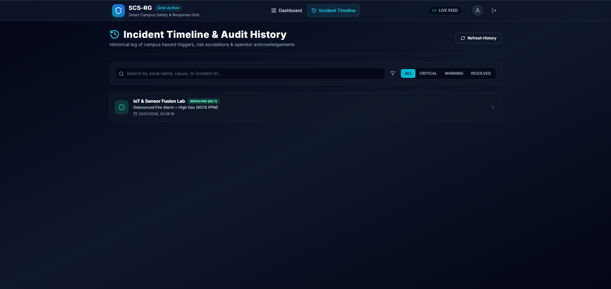
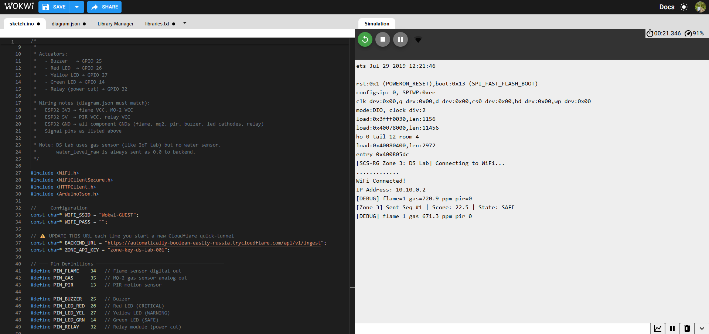
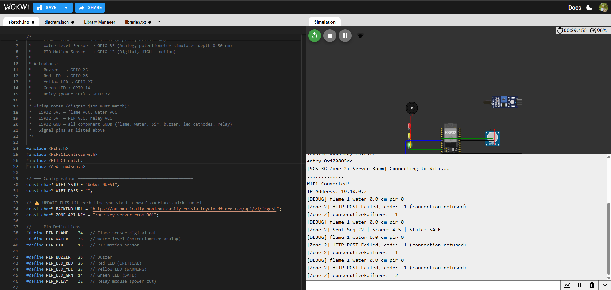
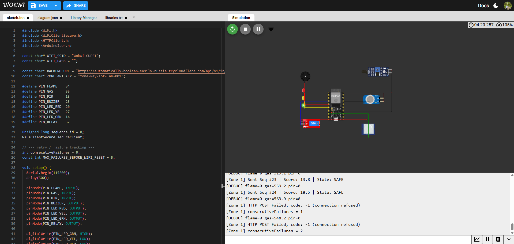

# SentinelGrid: Smart Campus Safety & Response Grid (SCS-RG)


---

## Executive Summary

**SentinelGrid (SCS-RG)** is an end-to-end, enterprise-grade **Smart Campus Safety & Automated Response Grid**. It bridges physical IoT edge nodes (ESP32 microcontrollers simulating complex multi-hazard environments) with a high-performance **asynchronous FastAPI backend**, an intelligent **Multi-Hazard Risk Fusion Engine**, deterministic **Closed-Loop Actuation Logic**, live **WebSocket telemetry feeds**, and an interactive **React + TypeScript Operational Command Dashboard**.

Whether monitoring chemical laboratories, high-density server rooms, or robotics facilities, SentinelGrid detects environmental hazards in real time, computes dynamic multi-factor risk scores, triggers immediate hardware-level safety countermeasures (buzzers, tri-color status LEDs, power cutoff relays), and prioritizes emergencies in an automated campus queue for dispatch responders.

---

## Dashboard and Simulation Screenshots

| Main Multi-Zone Live Dashboard | Incident Timeline and Real-Time Feed |
|:------------------------------:|:------------------------------------:|
|  |  |

| Zone 1: IoT & Sensor Fusion Lab | Zone 2: Central Server Room | Zone 3: Data Science & AI Lab |
|:-------------------------------:|:---------------------------:|:-----------------------------:|
|  |  |  |

---

## System Architecture

```mermaid
flowchart TB
    subgraph EDGE["Edge Telemetry Layer (Wokwi / ESP32 Nodes)"]
        Z1["Zone 1: IoT Lab<br/>(Flame, MQ-2 Gas, PIR)"]
        Z2["Zone 2: Server Room<br/>(Flame, Water Potentiometer, PIR)"]
        Z3["Zone 3: DS Lab<br/>(Flame, MQ-2 Gas, PIR)"]
    end

    subgraph TUNNEL["Secure Cloud Ingress Layer"]
        CF["Cloudflare Quick Tunnel<br/>(https://*.trycloudflare.com)"]
    end

    subgraph BACKEND["FastAPI Central Engine (Port 8000)"]
        INGEST["POST /api/v1/ingest"]
        RFE["Multi-Hazard Risk Fusion Engine<br/>Score = 40(Fire) + 25(Gas) + 20(Water) + 15(Occ)"]
        ACTUATION["Closed-Loop Actuator Decision<br/>(Buzzer, Tri-Color LED, Relay Cutoff)"]
        DB[("Async SQLite DB<br/>SQLAlchemy 2.0")]
        AUTH_MOD["RBAC & JWT Security Module<br/>(Admin & Staff Tokens)"]
        WS_MGR["WebSocket Broadcast Manager<br/>(/ws/updates)"]
    end

    subgraph FRONTEND["React 18 Operational Dashboard (Port 5173)"]
        FE_WS["WebSocket Live Telemetry Listener"]
        FE_UI["Zone Status Grid, Priority Queue & Admin Panel"]
    end

    Z1 & Z2 & Z3 -->|HTTPS Post JSON| CF
    CF -->|Proxy Request| INGEST
    INGEST --> RFE
    RFE --> ACTUATION
    ACTUATION -->|Sync HTTP Response| CF
    CF -->|Actuator Command| Z1 & Z2 & Z3
    RFE --> DB
    RFE --> WS_MGR
    WS_MGR -->|Push JSON Telemetry| FE_WS
    FE_WS --> FE_UI
```



---

## Codebase Directory Structure

```text
sentinel-grid/
├── backend/
│   ├── app/
│   │   ├── api/
│   │   │   └── v1/
│   │   │       ├── endpoints/
│   │   │       │   ├── admin.py          # Admin overrides, audit logs & zone controls
│   │   │       │   ├── auth.py           # JWT login, refresh & authentication
│   │   │       │   ├── incidents.py      # Incident lifecycle & acknowledgements
│   │   │       │   ├── ingest.py         # Telemetry intake & sequence deduplication
│   │   │       │   └── zones.py          # Zone statuses & priority emergency ranking
│   │   │       └── router.py             # API route aggregator
│   │   ├── auth/
│   │   │   ├── jwt.py                    # Token creation & decoding logic
│   │   │   ├── password.py               # Bcrypt password verification & hashing
│   │   │   └── rbac.py                   # Role-based access dependencies (Admin/Staff)
│   │   ├── bonus/
│   │   │   └── trend/                    # Linear regression hazard trend forecasting
│   │   ├── core/
│   │   │   └── config.py                 # Pydantic environment configuration
│   │   ├── database/
│   │   │   ├── base.py                   # Declarative base class
│   │   │   └── session.py                # Async engine & session provider
│   │   ├── models/                       # SQLAlchemy 2.0 ORM models
│   │   │   ├── acknowledgement.py
│   │   │   ├── audit.py
│   │   │   ├── incident.py
│   │   │   ├── reading.py
│   │   │   ├── role.py
│   │   │   ├── token.py
│   │   │   ├── user.py
│   │   │   └── zone.py
│   │   ├── repositories/                 # Data access repositories
│   │   ├── schemas/                      # Pydantic validation schemas
│   │   ├── services/
│   │   │   ├── actuation.py              # Actuator decision matrix
│   │   │   ├── debounce.py               # Signal debouncing & node heartbeat
│   │   │   ├── incident_service.py       # Incident state transitions & recovery
│   │   │   ├── priority_ranking.py       # Multi-factor emergency queue sorting
│   │   │   └── risk_fusion.py            # Weighted risk scoring engine
│   │   └── websocket/
│   │       ├── manager.py                # Connection manager & broadcasting
│   │       └── router.py                 # WebSocket endpoint handler
│   ├── scripts/
│   │   └── seed_data.py                  # Default roles, users & zones seeder
│   ├── tests/
│   │   └── test_backend.py               # Automated pytest suite
│   ├── main.py                           # Application entry point & lifespan
│   ├── requirements.txt                  # Python dependency definitions
│   └── .env.example                      # Environment template
├── frontend/
│   ├── src/
│   │   ├── components/
│   │   │   ├── common/Header.tsx
│   │   │   ├── dashboard/                # Zone cards, priority queue, toasts
│   │   │   └── incidents/IncidentTimeline.tsx
│   │   ├── context/
│   │   │   ├── AuthContext.tsx           # Authentication state & persistent session
│   │   │   └── WebSocketContext.tsx      # Auto-reconnecting real-time stream
│   │   ├── pages/
│   │   │   ├── AdminPage.tsx             # State overrides, audit trail & zone toggles
│   │   │   ├── DashboardPage.tsx         # Live telemetry & risk overview
│   │   │   ├── IncidentTimelinePage.tsx  # Incident log & operator acknowledgement
│   │   │   └── LoginPage.tsx             # Portal access with demo credential switch
│   │   ├── services/api.ts               # Axios instance with 401 token refresh interceptor
│   │   ├── types/index.ts
│   │   ├── utils/api.ts
│   │   ├── App.tsx
│   │   └── main.tsx
│   ├── package.json
│   ├── tailwind.config.js
│   ├── tsconfig.json
│   └── vite.config.ts
├── simulation/
│   └── wokwi/                            # ESP32 simulations per zone
│       ├── zone1_iot_lab/
│       ├── zone2_server_room/
│       └── zone3_ds_lab/
├── screenshots/
└── README.md
```

---

## Key Features

1. **Multi-Hazard Risk Fusion Engine**:
   - Calculates dynamic composite risk scores (0.0 to 100.0) based on weighted sensor inputs:
     $$\text{Risk Score} = 40 \times \text{Fire} + 25 \times \text{Gas}_{\text{normalized}} + 20 \times \text{Water}_{\text{normalized}} + 15 \times \text{Occupancy}$$
   - Classifies zones dynamically:
     - **SAFE** (< 30)
     - **WARNING** (30 - 64)
     - **CRITICAL** (>= 65)

2. **Deterministic Closed-Loop Hardware Actuation**:
   - Emits instantaneous actuation directives within the sync HTTP response:
     - **SAFE**: Green LED ON, Buzzer OFF, Relay NORMAL (Power ON).
     - **WARNING**: Yellow LED ON, Buzzer OFF, Relay NORMAL.
     - **CRITICAL**: Red LED ON, Buzzer ALARM ON, Relay TRIP (Emergency Power Cut).

3. **Role-Based Access Control (RBAC) & Session Management**:
   - Secure JWT authentication with Access and Refresh tokens.
   - Dual-role authorization separating Administrator operations (Manual overrides, zone deactivations, audit inspection) from Responder Staff permissions (Incident acknowledgements).

4. **Automated Incident Lifecycle & Priority Ranking**:
   - Tracks incident opening, duration, peak risk scores, and automatic resolution when safe sensor conditions persist.
   - Real-time emergency queue sorted dynamically by composite risk score, human occupancy weighting, and incident duration.

5. **Tamper-Evident System Audit Trail**:
   - Logs administrative manual overrides, status alterations, and emergency responder acknowledgements into a structured audit repository.

6. **Predictive Risk Trend Analysis**:
   - Bonus linear regression model evaluates rolling telemetry windows to detect rising hazard slopes before thresholds are breached.

7. **Zero-Configuration Live WebSocket Stream**:
   - Pushes sub-second telemetry updates, state transitions, and operator interventions directly to connected clients without browser polling.

---

## Technology Stack

### Edge & Hardware Simulation
- **Platform**: Wokwi Microcontroller Simulator (ESP32 DevKit-C V4)
- **Firmware**: C++ / Arduino Framework (`WiFiClientSecure`, `HTTPClient`, `ArduinoJson`)

### Backend Engine
- **Framework**: Python 3.10+ / FastAPI (Asynchronous ASGI server)
- **Web Server**: Uvicorn
- **ORM / Database**: SQLAlchemy 2.0 Async + SQLite (Configurable to PostgreSQL / Supabase)
- **Security**: PyJWT, Bcrypt, API-Key Header Authentication (`X-Zone-API-Key`)

### Frontend Dashboard
- **Framework**: React 18 with TypeScript
- **Build Tool**: Vite 5.4
- **Styling**: Vanilla CSS + TailwindCSS (Glassmorphism layout, responsive dark UI)
- **Icons**: Lucide React
- **Data Synchronization**: TanStack React Query v5 + WebSockets

---

## Campus Zone Hardware Wiring Specifications

All zones utilize the ESP32 DevKit-C V4 board paired with designated sensor configurations:

### Common Pinouts (All Zones)
| Device / Function | ESP32 GPIO Pin | Pin Mode | Logic / State |
|-------------------|----------------|----------|---------------|
| **Flame Sensor** | GPIO 34 | Digital INPUT | Active-LOW (LOW = Flame Detected) |
| **PIR Motion Sensor** | GPIO 13 | Digital INPUT | Active-HIGH (HIGH = Occupied) |
| **Buzzer** | GPIO 25 | Digital OUTPUT | HIGH = Alarm Active |
| **Red LED (Critical)** | GPIO 26 | Digital OUTPUT | HIGH = Active |
| **Yellow LED (Warning)** | GPIO 27 | Digital OUTPUT | HIGH = Active |
| **Green LED (Safe)** | GPIO 14 | Digital OUTPUT | HIGH = Active |
| **Relay Power Cut** | GPIO 32 | Digital OUTPUT | HIGH = Emergency Cutoff |

### Zone Specific Sensors
* **Zone 1 (IoT & Sensor Fusion Lab)**: Gas Sensor (MQ-2) on **GPIO 35** (Analog)
* **Zone 2 (Server Room)**: Water Depth Sensor (Potentiometer) on **GPIO 35** (Analog)
* **Zone 3 (Data Science & AI Lab)**: Gas Sensor (MQ-2) on **GPIO 35** (Analog)
* **Zone 4 (Autonomous Robotics Lab)**: Gas Sensor (MQ-2) on **GPIO 35** and Water Depth Sensor on **GPIO 33**

---

## Cloudflare Tunnel Setup

Because Wokwi runs in a browser sandbox environment, it requires a secure public HTTPS endpoint to send telemetry to your local backend.

### 1. Install Cloudflare CLI (`cloudflared`)
- **Linux**:
  ```bash
  sudo apt-get install cloudflared || sudo pacman -S cloudflared
  ```
- **macOS**:
  ```bash
  brew install cloudflared
  ```
- **Windows**:
  ```powershell
  winget install Cloudflare.cloudflared
  ```

### 2. Start Cloudflare Quick Tunnel
With the FastAPI backend running on port 8000:
```bash
cloudflared tunnel --url http://localhost:8000
```

### 3. Update Firmware Backend URL
Copy the generated URL (e.g. `https://random-subdomain.trycloudflare.com`) and update `BACKEND_URL` in `sketch.ino`:
```cpp
const char* BACKEND_URL = "https://<your-tunnel-subdomain>.trycloudflare.com/api/v1/ingest";
```

---

## Step-by-Step Installation and Running Guide

### 1. Prerequisites
- **Python**: 3.10 or higher
- **Node.js**: v18.0 or higher (with `npm`)
- **Cloudflare CLI**: `cloudflared` (for remote/Wokwi testing)

---

### 2. Backend Setup

```bash
# Navigate to backend directory
cd backend

# Create and activate virtual environment
# On Linux/macOS:
python3 -m venv .venv
source .venv/bin/activate

# On Windows:
# python -m venv .venv
# .\.venv\Scripts\Activate.ps1

# Install dependencies
pip install -r requirements.txt

# Start backend server
python -m uvicorn main:app --reload --host 0.0.0.0 --port 8000
```

*Note: The database seeds default roles, users (`admin`/`admin123`, `staff`/`staff123`), and campus zones automatically upon first boot.*

---

### 3. Frontend Setup

In a separate terminal:

```bash
# Navigate to frontend directory
cd frontend

# Install npm dependencies
npm install

# Start Vite development server
npm run dev
```

Open your browser at `http://localhost:5173` to access the SentinelGrid Portal.

---

### 4. Running Edge Simulations (Wokwi)

1. Open any Wokwi simulation folder (e.g., `simulation/wokwi/zone1_iot_lab`).
2. Insert your active Cloudflare HTTPS URL into `sketch.ino`.
3. Start the simulation.
4. Interact with the hardware sensors (adjust gas/water levels, toggle flame, move PIR sensor).
5. Verify instant actuation response on physical simulation LEDs while the web dashboard reflects live risk changes.

---

## API Endpoint Reference

| Method | Endpoint | Authorization | Description |
|--------|----------|---------------|-------------|
| **POST** | `/api/v1/ingest` | Header `X-Zone-API-Key` | Ingests raw telemetry from ESP32 edge nodes and returns actuation directives. |
| **GET** | `/api/v1/zones` | Public | Returns status, risk scores, connectivity, and priority queue for all zones. |
| **GET** | `/api/v1/zones/status` | Public | Alias for zone status overview. |
| **GET** | `/api/v1/incidents` | Public | Filterable list of active and historical campus safety incidents. |
| **POST** | `/api/v1/incidents/{id}/ack` | Bearer (Staff/Admin) | Acknowledges an active incident with atomic DB-level single-responder locking. |
| **POST** | `/api/v1/incidents/{id}/acknowledge` | Bearer (Staff/Admin) | Alias endpoint for incident acknowledgement. |
| **POST** | `/api/v1/auth/login` | Public | Authenticates credentials and issues Access + Refresh JWT tokens. |
| **POST** | `/api/v1/auth/refresh` | Public | Issues a new Access token using a valid Refresh token. |
| **POST** | `/api/v1/admin/override` | Bearer (Admin only) | Manually forces a zone into SAFE, WARNING, or CRITICAL state with mandatory audit justification. |
| **GET** | `/api/v1/admin/health` | Bearer (Admin only) | Returns system diagnostics, active nodes count, and database health metrics. |
| **GET** | `/api/v1/admin/audit-logs` | Bearer (Admin only) | Fetches the recent chronological system audit trail. |
| **PATCH** | `/api/v1/admin/zones/{id}` | Bearer (Admin only) | Enables or disables telemetry processing for a specific zone. |
| **GET** | `/api/v1/bonus/trend/{id}` | Public | Returns linear regression slope and anomaly warning trends for a zone. |
| **WS** | `/ws/updates` | Public | Real-time WebSocket telemetry and incident alert broadcast channel. |

---

## Default User Accounts

| Username | Password | Assigned Role | Permissions |
|----------|----------|---------------|-------------|
| `admin` | `admin123` | Administrator | Full administrative override, zone management, audit log access, incident ack |
| `staff` | `staff123` | Security Staff | View dashboards, monitor alerts, acknowledge active emergencies |

---

## Testing and Verification

To execute the automated backend test suite:

```bash
cd backend
python -m pytest tests/
```

To run TypeScript verification:

```bash
cd frontend
npx tsc --noEmit
```

---

## License

Distributed under the MIT License. See `LICENSE` for details.

---

<p align="center">
  <b>SentinelGrid: Smart Campus Safety & Response Grid</b> — Developed for Next-Generation Connected Smart Campuses.
</p>
